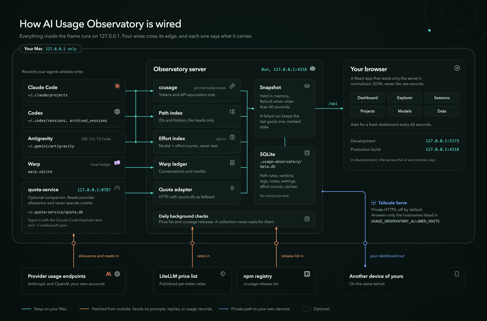

# Architecture and data contracts

<a href="setup-diagram.png">
  
</a>

<sub>Click for full size. The editable source is <a href="setup-diagram.svg"><code>setup-diagram.svg</code></a>.</sub>

## Boundary

The React frontend only consumes normalized local API responses. It never reads agent records or raw `ccusage` JSON directly.

`src/App.tsx` owns navigation, global filters, and the application shell. Each of the six views
loads through a dynamic import. Shared calculations live in `src/app/analytics.ts`; charts,
session detail, quota cards, and dialogs have separate component modules. The dashboard hook
lives in `src/hooks/use-dashboard.ts`.

`server/app.ts` exports the request handler separately from `server/index.ts`, which starts the
listener. API mutations reject unapproved browser origins and cross-site requests. Originless
clients can write only through a loopback host. Endpoints with JSON bodies require
`application/json` and validate their payloads before writing. Invalid input returns 400;
an unsupported content type returns 415.

## In-app update

`bun run start` runs `scripts/launcher.ts`. The launcher spawns `server/index.ts` in its own
process group with `USAGE_OBSERVATORY_MANAGED=1`, a per-start boot id, and a Bun IPC channel
(`server/update/ipc.ts`, protocol `v: 1`). It holds `.usage-observatory/launcher.lock`, signals
only its own child, and exits when that child exits outside an update. The server exits when its
launcher disappears. `bun run dev` and `bun run start:server` run no launcher.

- **Check** (`server/update/git.ts`) runs fixed Git argv without a shell and without prompts. It
  rejects unsupported checkouts (not `main`, detached, no `origin`, other upstream, shallow,
  linked worktree, sparse, submodules), in-progress Git operations, and then fetches only
  `origin/main`. A `behind`, clean, collision-free result whose target `package.json` declares the
  same `updaterProtocol` is eligible. A check expires after 10 minutes. The launcher keeps only
  the latest check in memory.
- **Apply** (`server/update/job.ts`) is bound to a `checkId`. It revalidates the checkout without a
  new fetch, persists the job to `.usage-observatory/update-job.json`, and answers `202`. Phases:
  `stopping` (the maintenance server in `server/update/maintenance.ts` takes the port),
  `backing-up` (`VACUUM INTO` plus `integrity_check`), `applying` (`git merge --ff-only
  --no-autostash --no-overwrite-ignore`, then HEAD and tree reconciliation into `gitState`),
  `installing`, `building`, `starting`, and `verifying`. Verification requires
  `/api/update/version` to report the target commit, the new boot id, and the child PID, and
  `dist/build-info.json` to name the target. Only then is the job `complete`.
- A failure before the merge restarts the previous server. A failure after the merge keeps the
  maintenance server up; Retry resumes at the first unfinished step when HEAD is still the target
  and the tree is clean. A launcher restart marks an unfinished job `failed/interrupted`.
- `/api/update/*` (`server/update/routes.ts`) never waits for the snapshot. Update POSTs require
  `Content-Type: application/json`, `X-Observatory-Action: update`, and an exact app or Vite
  Origin (`server/update/policy.ts`); a remote origin can apply only with
  `USAGE_OBSERVATORY_REMOTE_UPDATES=1`.
- `runMigrations` reports `schemaAhead` when the database is newer than the build. Startup
  continues, and the UI shows a warning.

The browser side is `src/hooks/use-update.ts` and `src/components/update-control.tsx`: one
button whose label names the next action, and an information panel on hover, focus, or click. The hook
mounts before the dashboard loading and error screens, polls during a job, treats network errors
as a restart for up to 15 minutes, and reloads once when the job completes.

## Collection flow

1. The server invokes the project-pinned `node_modules/.bin/ccusage` binary. It runs without
   `--offline`, so ccusage fetches LiteLLM pricing and falls back to its embedded catalog when
   that fetch fails.
   Each subprocess has a 60-second deadline. A timeout terminates only that child and follows
   the existing collection-failure path that retains the prior snapshot.
2. Zod validates unified, block, and Claude project-instance reports.
3. The pricing rate card resolves from the SQLite cache or the bundled
   `server/rate-card-fallback.json`, and refreshes from LiteLLM in the background once a day
   (never awaited by a collection tick; `USAGE_OBSERVATORY_OFFLINE_PRICING=1` pins it offline).
   The card only ever splits a ccusage cost into token types: input, output, and cache-read cost
   are rate times tokens, cache-write cost is the residual, and a model-row is shown with cost
   only when that residual lands where the card says a cache write can cost. Codex rows must
   match exactly; Claude rows may land anywhere between the all-5-minute and all-1-hour
   cache-write bounds because ccusage prices 1-hour writes at the higher rate. Anything else is
   withheld, never repriced.
   The same pattern tracks the pin: `server/ccusage-upstream.ts` reads the ccusage release list
   from the npm registry once a day, caches it in SQLite, and honors the same offline switch.
   The ccusage source-health entry shows how many stable releases the pin trails, and reads as
   degraded once the pin has trailed for more than 30 days. The check never upgrades anything.
3. The metadata-only path indexer incrementally reads session file heads when mtimes change. It
   indexes Claude and Codex transcripts, and the `events.jsonl` of each Copilot session for its
   working directory only. Copilot files never enter the effort catalog, but they are part of
   the fingerprint that decides whether ccusage runs again. So is every Antigravity conversation
   database and its `-wal` (stat only, never opened by the indexer), so a new call, even one that
   lands only in the log, triggers a re-collection. An agent that `providerFromAgent`
   does not recognize has no quota, effort index, or chart series; the Agent filter still lists
   it, and both analysis endpoints scope it through the `other` provider value.
4. Native report sessions are joined to indexed paths without copying transcript content.
   Warp (`server/warp.ts`) sits beside `ccusage` and reads Warp's SQLite ledger.
   Google Antigravity is a `ccusage` agent with a metadata reader beside it:
   - **ccusage.** ccusage reads Antigravity's per-conversation SQLite databases itself, but finds
     only its default directories (`~/.gemini/antigravity`, `-cli`, `-ide`, `-backup`, `-acp`,
     `~/.config/antigravity`), never T3 Code's driver directory
     (`~/.t3/userdata/providers/antigravity/*/antigravity-acp/`). `server/ccusage.ts` passes
     every existing root, comma-separated, in `ANTIGRAVITY_DATA_DIR`, which replaces ccusage's
     search; `ANTIGRAVITY_DATA_DIRS` replaces the list for both readers. A root whose path holds a
     comma cannot be put in ccusage's list, so it is left out and named in source health. ccusage
     supplies the sessions (`period` is the conversation ID), daily, weekly, and monthly rows,
     totals, and the API-equivalent cost, priced from models.dev and LiteLLM, with thinking
     billed as output.
     ccusage opens these databases with normal SQLite reads and can leave `-wal`/`-shm` files.
   - **Thinking tokens.** ccusage counts Antigravity's thinking in `totalTokens` but not in
     `outputTokens`, so its buckets fall short of the total by exactly the thinking. Every other
     agent's buckets add up. `foldAntigravityThinking` folds the gap into output on every
     Antigravity row, agent sub-row, session, model breakdown, and the totals. That matches
     Codex, whose output already holds its reasoning, and matches the price, so totals,
     token-type shares, and per-model sums agree. Model breakdowns carry no total of their own,
     so a row with several models splits its gap by each model's output tokens; that per-model
     split is an estimate, the row totals are exact. The thinking count itself comes from the
     metadata reader (`reasoningOutputTokens`), a subset of output, as Codex's is.
   - **Metadata reader.** `server/antigravity.ts` reads the same roots for what ccusage lacks:
     the working directory (`workspace_uris`), effort labels, the thinking split, step times and
     activity evidence, the effort-store rows, and source health. It emits no session, row,
     total, or cost. The collector joins it onto ccusage's sessions by conversation ID; the
     session ID is `antigravity-<conversation_id>` either way. Source health compares ccusage's
     Antigravity session count and token total with the reader's.
   - **Ledger.** Each usage-bearing step's `steps.metadata` field 9 is one model call: uncached
     input, output (thinking included), cache write, cache read, and the thinking share of
     output, de-duplicated by message ID. Compaction calls count; they carry their own message
     IDs. Field 1 is the call's UTC time. `step_payload` is never selected. A finished model turn
     (`steps.status` 3) without a usage record is noted in source health; a turn still running
     has not written its record yet and is not.
   - **Model and effort.** `gen_metadata` maps each message ID to its model ID and display label,
     so a mid-conversation effort switch is attributed per call. Rows are scanned incrementally
     by `idx`; only three fields are decoded, and rows over 16 MiB are skipped in SQL. The reader
     relies on the observed contract that rows are appended and only the newest can still be
     completed in place: each pass reads again from the last `idx` it read, and a change to an
     older row is seen only when the file is replaced.
   - **Open rule.** Read-only, with a short busy timeout. A `-wal` without a `-shm` is never
     opened plainly, because a read-only connection would create the `-shm`: an empty one is read
     with `immutable=1` and a non-empty one is skipped. Bun reports `SQLITE_CANTOPEN` (a closed
     WAL file with no sidecars) on the first query, which falls back to `immutable=1`; that read is
     kept only if the main file and `-wal` are unchanged after it. An unsafe read keeps the last
     good parse and is noted in source health. A `conversations` directory that is missing has no
     conversations; one that cannot be listed (permissions, I/O) keeps every parse cached under
     that root, is noted, and marks the collection incomplete, so no session is pruned.
   - **Evidence.** Step times become activity evidence through `saveLocalEvidence`; a summary's
     modified time orders a session but never stands in for activity.
   - **Cost.** Antigravity cost is ccusage's, like Claude's and Codex's. Offline, ccusage has no
     Gemini 4 price and names the model in `unpricedModels`; sessions that ran an unpriced model
     stay out of cost medians and rates. LiteLLM has no Gemini 4 rate, so the token-type cost
     split is withheld for it with the `no-rate` reason.
   - **Vendor grouping.** "Antigravity" means the Gemini subscription. A Gemini model run by
     another agent (Warp) stays that agent's session, scope, and quota. `providerFromModel` does
     not map Gemini to any provider; `modelGroup(model, agent)` places it under Antigravity only
     when Antigravity ran it, and under the Google vendor label otherwise. The Agent filter lists
     a Gemini family under each group whose agent ran it, with a separate entry in each:
     `antigravity:<family>` under Antigravity and `model:<family>` under Google. Each matches only
     its own agents' sessions, so neither checks, clears, or collapses the other; the same tokens
     reach `/api/effort` and `/api/insights` as `modelFamilies`.
5. Project activity groups joined session totals by provider, working directory, and local last-activity day. A session spanning multiple days is attributed to its latest activity day.
6. Path rules are evaluated on demand, so edits apply retroactively.
7. A successful in-memory snapshot replaces the prior one. A failure preserves the last success and marks it stale.
8. When the private effort index is enabled, the complete reconciled path catalog schedules an
   incremental byte scan after the snapshot succeeds. Requests never await transcript parsing.

## Stable session identity

```text
session_id = sha256(agent + NUL + source_file_relative_path + NUL + native_session_key)[0:24]
```

Agent and source path namespace native identifiers. Sessions from provider databases rather
than transcript files are keyed by their provider's own conversation ID: `warp-<id>` and
`antigravity-<conversation_id>`. Neither includes a machine path, so a reinstall keeps
annotations. The source path and key are taken from the agent record, not from mutable `ccusage` display ordering. If a future pinned ccusage version changes native session keys, an explicit compatibility map must be added before upgrade; unmapped rows must be surfaced in source health rather than silently orphaning annotations.

A Codex transcript moved between the active and archive roots retains its existing ID when
the native key and filename match and the prior file no longer exists. Existing archived IDs
remain unchanged. For standard dated `rollout-YYYY-MM-DDT...` filenames, indexing can reconstruct
the former active-path ID and recover orphaned annotations. Migration 11 records that ID as an
alias. Recovery unions tags and retains both notes. The current verdict wins a conflict; the
former verdict is retained in the note. Unrecognized filenames are not guessed.

## Local storage

SQLite stores path rules, session working-directory metadata, manual annotations, settings, and
optional derived effort aggregates. Reports remain in memory and are recomputed on refresh. Raw
prompts and responses are never duplicated.

## Reasoning-effort index

The effort index is disabled by default. Enabling it builds a recent-first backlog from the full
current source catalog and then continues through older history. Each session stores a byte offset,
resume-boundary hash, parser version, active Codex attribution state, aggregate quality counters,
and grouped categorical/numeric usage. A span transaction advances the offset and aggregates
together, so interrupted work can resume without double-counting.

Claude assistant usage events and Codex turn contexts are observation boundaries. Codex token
events use `last_token_usage`; cached input remains a subset of input and reasoning output remains
a subset of output. Codex usage follows the rules of the pinned ccusage so both count the same
records: a `last_token_usage` snapshot counts only when the cumulative `total_token_usage`
advanced, and a record that states only the cumulative total adds the growth since the previous
one. A fork or subagent rollout subtracts the usage its parent recorded up to the fork instant
(`server/codex-replay.ts` reads the parent log through the path index); when no parent record
lines up, it skips the burst of records Codex rewrote to the fork instant, for as long as
successive records stay within one second of each other. The cumulative total and the replay
position persist with the parser state, so a resumed span continues where the last one stopped.
Malformed relevant records clear active attribution and surface quality counters.

Antigravity effort rows do not pass through the byte-offset index. The collector already holds
each call's model, label, and tokens, so `server/antigravity-effort.ts` writes them after each
successful collection: a `session_paths` row (agent `antigravity`) for every session, and, only
while the index is enabled, one replacement of that session's effort state and rows whenever its
database signature changes, in one transaction. A pass that began before derived data was deleted
writes nothing. After a collection that read every source, rows for conversations that are gone
are pruned, and the foreign-key cascade removes their effort rows. These sources never enter the
transcript catalog or `PARSER_VERSION`; their databases enter the `ccusage` fingerprint only.

The database never stores prompt or response content, reasoning text, commands, tool payloads,
file contents, or transcript fragments. Disabling retains derived rows but excludes them from
analysis. Deleting derived observations disables indexing and removes only the two effort-derived
tables' contents.

Effort freshness is independent of `/api/dashboard`. Status polling watches the private index
version; aggregate, combo, and session-digest ETags include both snapshot and index versions.
Data's effort facet also includes the index version in `/api/insights` because it selects whole
sessions before existing metrics are computed.

## Model family x effort

The unit of comparison is the **combo**: `{ family, effort }`, where family comes from `familyOf()`
and effort is the provider-recorded label, normalized but never inferred. An effort value on its
own is not a decision unit — `Opus 5 · High` and `Sol · High` are different cohorts. `src/combo.ts`
owns the vocabulary (keys, labels, colours, facet encoding, series selection) and is shared by the
server and the client so a model can never be grouped one way in a chart and another in a filter.

`/api/effort/combo-days` returns day rows of family x effort buckets. Raw model variants collapse
to families in TypeScript, not SQL, and reconciliation stays **per day** against the existing
authoritative day total: there is no `(day, model)` denominator, so a multi-day session allocated
to its last-activity day cannot suppress otherwise-valid model cells. Days present only in the
denominator are returned as all-unknown coverage rather than disappearing.

`/api/effort/combos` is the scoreboard. Tokens, observations, appearances, and reasoning share are
combo-attributable. Median tokens, median cost, efficiency flag rate, and verdict are *whole-session*
statistics over the sessions a combo **uniquely led** — the single combo with strictly more
attributed tokens than every other. A tie is not broken alphabetically: those sessions contribute
volume to every combo present and outcomes to none. Comparative cells need five led sessions;
verdict rates need five ratings, counted separately. Automated, synthetic, and unrecorded-model
rows keep their volume and never receive comparative metrics. Flag rate comes from an untruncated
pass over the efficiency rules, not from the 80-item public findings array.

Reasoning share is `reasoningOutputTokens / outputTokens`, and is `null` when the provider reported
no reasoning events at all. A provider-reported zero stays zero; the two are distinguished by the
event count, never by the sum.

The session digest is version 2 and carries family and effort as separate indexes plus a per-session
combo bitmask, so the Sessions table can render, sort, search, and filter by dominant combo. "Mixed
effort" (two or more distinct efforts) and "multiple combos" are separate flags. The Data effort
facet is one field extended rather than duplicated: `all`, `mixed`, `unknown`, `value:<effort>`, and
`combo:<JSON tuple>`. A combo selection chooses **sessions**; those sessions keep every other combo
they recorded in each downstream metric.

## Session verdict

`verdict` is the user's own rating of a session (`good`, `mixed`, `bad`, or unrated). It is never
inferred from tokens, cost, effort, or any heuristic, and it is the only user-supplied signal in the
app. Annotation writes are field-preserving: `setAnnotationText()` cannot clear a verdict and
`setVerdict()` cannot clear tags or a note.

A verdict changes neither `collectedAt` nor the effort index version, so `annotation_meta.version`
is bumped in the same transaction as every write. The cached dashboard snapshot re-overlays
annotations when that revision changes — no ccusage recollection — and the revision is part of both
the dashboard ETag and the combo-scoreboard ETag.

The dashboard ETag also includes refresh status and its error, so a collection failure or
recovery reaches the browser even when the last successful collection time stays unchanged.

## Quota integration

[`quota-service`](https://github.com/anobjectn/quota-service) remains an optional, separate localhost dependency. The adapter reads `/usage`, `/resets`, `/status`, bounded `/history` pages, and optional Claude lifecycle markers. Endpoint failures are independent. A recognized local SQLite database provides a read-only history fallback for older service versions, and is additionally read on the connected path for model-specific windows that the `/history` contract drops. Session quota context joins that account-level evidence to locally indexed activity episodes and never allocates provider movement to a thread: movement is reported as remaining-quota ranges per quota cycle, plus a closing balance per resource that stays valid even when movement is blanked as inconsistent. The allowance-comparison report de-duplicates account movement once per quota cycle across overlapping cohort members. It does not supply analytical cost, so two cost methodologies cannot appear for the same activity.

Antigravity reports its five-hour and weekly windows plus named model windows (`model:<name>` in
history), each described by `extra.modelWindowIdentity` on `/usage`. `src/antigravity-quota.ts`
reads that record with quota-service's fail-closed rule, copied rather than imported: an exact
model ID limits only that model, the partner pool limits no Gemini model, an image pool limits no
text model, and a window with no record limits every Gemini model. A session's quota context keeps
only the windows that limit its models, and its movement tolerance is one reporting unit (0.1
point) plus slop. Local model-window rows are merged into `/history` only for (`observedAt`,
window) pairs `/history` lacks, so no window is counted twice. Capacity rows, the orrery, the
headroom overlay series, quota-reach markers, recent-list window boundaries, and the allowance
capture profile read the primary five-hour and weekly windows only, exactly as for Claude and
Codex; model windows never enter them. A provider that a
successful `/usage` no longer reports is dropped from the last-good cache, so a disabled provider
does not return during a later outage.
